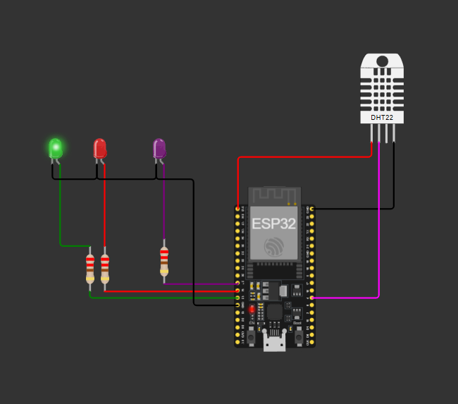
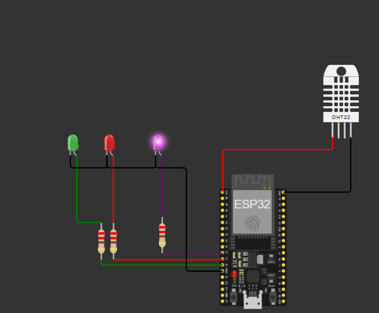

# Sistema Embarcado de Monitoramento de Temperatura com Máquina de Estados

Projeto desenvolvido para avaliação técnica em Sistemas Embarcados. O sistema realiza a aquisição periódica de temperatura utilizando um microcontrolador **ESP32** e um sensor digital **DHT22**, operando sob uma arquitetura baseada em máquina de estados não-bloqueante com margem de histerese e detecção de falhas de hardware.

🔗 **Simulação Interativa no Wokwi:** [Acesse e teste o projeto online aqui](https://wokwi.com/projects/480932210098746369)

---

## Circuito e Arquitetura de Hardware

### Mapeamento de Pinos (Pinout)

| Componente | Pino no ESP32 | Função no Sistema |
| :--- | :--- | :--- |
| **Sensor DHT22 (SDA)** | `GPIO 4` | Entrada de dados digitais de temperatura |
| **LED Verde** | `GPIO 12` | Indicador visual do estado **NORMAL** |
| **LED Vermelho** | `GPIO 14` | Indicador visual do estado **ALERTA** |
| **LED Azul/Roxo** | `GPIO 27` | Indicador visual do estado **FALHA** |

---

## Atendimento aos Requisitos Funcionais (RF01 a RF06)

* **RF01 — Aquisição Periódica Não-Bloqueante:** As leituras ocorrem exatamente a cada **2000 ms (2 segundos)** utilizando o temporizador interno `millis()`. O uso de `delay()` no loop principal foi evitado para manter a CPU livre e responsiva.
* **RF02 — Exibição Padronizada:** A cada ciclo de leitura, o **Monitor Serial (115200 baud)** exibe a temperatura atual, o limite parametrizado e o estado ativo do sistema, sincronizado com o acionamento exclusivo do respectivo LED indicador.
* **RF03 e RF04 — Limite Térmico, Máquina de Estados e Histerese:**
  * **Limite de Alerta (`LIMITE_TEMP`):** Definido em **30.0 °C**. Leituras acima deste valor transicionam o sistema para `ESTADO_ALERTA`.
  * **Margem de Histerese (`HISTERESE`):** Definida em **1.0 °C**. Uma vez em alerta, o sistema só retorna ao `ESTADO_NORMAL` quando a temperatura cai para **<= 29.0 °C**, prevenindo oscilações rápidas (*chattering*) caso a temperatura flutue exatamente sobre o limiar de 30.0 °C.
* **RF05 — Tratamento de Leitura Inválida (Falha):** A função `leituraValida()` verifica se o retorno do sensor é nulo (`isnan()`) ou se está fora da faixa física operacional do DHT22 (`-40.0 °C` a `80.0 °C`). Qualquer anomalia aciona imediatamente o `ESTADO_FALHA` (LED Azul/Roxo), impedindo que um erro de comunicação seja interpretado como temperatura normal.
* **RF06 — Demonstração Prática:** Todos os cenários operacionais podem ser validados em tempo real no simulador Wokwi seguindo o roteiro abaixo.

---

## Roteiro de Testes e Validação (Como Executar)

1. Acesse o link do projeto no [Wokwi](https://wokwi.com/projects/480932210098746369) e inicie a simulação clicando no botão **Play**.
2. **Cenário 1 — Operação Normal (Abaixo do Limite):**
   * Com a temperatura padrão (`24.0 °C`), observe o **LED Verde** aceso e a saída no Monitor Serial:
     `Temp: 24.0 °C | Limite: 30.0 °C | Estado: NORMAL`
3. **Cenário 2 — Acionamento de Alerta (Acima do Limite):**
   * Clique sobre o sensor **DHT22** durante a simulação e deslize o controle de temperatura para **`31.5 °C`**.
   * Na próxima janela de 2000 ms, o **LED Vermelho** acenderá e o Monitor Serial indicará:
     `Temp: 31.5 °C | Limite: 30.0 °C (Retorno <= 29.0 °C) | Estado: ALERTA`
4. **Cenário 3 — Validação da Histerese e Retorno ao Normal:**
   * Reduza a temperatura do sensor para **`29.5 °C`**. Note que o sistema **permanece em `ALERTA`**, comprovando a atuação da histerese.
   * Reduza a temperatura para **`28.5 °C`** (abaixo de 29.0 °C). O sistema retornará ao estado **`NORMAL`** e acenderá o **LED Verde**.
5. **Cenário 4 — Simulação de Leitura Inválida / Falha de Sensor (RF05):**
   * Com a simulação em andamento, remova a conexão do fio ligado ao pino **SDA** do DHT22 (`GPIO 4` do ESP32).
   * O sistema detectará a leitura inválida (`NaN`), acenderá exclusivamente o **LED Azul/Roxo** e exibirá no Monitor Serial:
     `Temp: INVALIDA | Estado: FALHA (Erro na leitura do sensor)`

---

## Estrutura do Repositório

* `sketch.ino`: Código-fonte principal em C++/Arduino estruturado com separação de responsabilidades (`leituraValida`, `avaliarEstado` e `atualizarSaida`).
* `temperatura_sensor.png`: Captura do circuito em operação normal no Wokwi.
* `demonstracao_falha.png`: Captura demonstrando a detecção de falha (LED roxo aceso após desconexão do pino `GPIO 4`).
* `README.md`: Documentação técnica, decisões arquiteturais e guia de validação.

---

## Declaração de Uso de Inteligência Artificial

Em conformidade com as diretrizes de transparência do processo seletivo, declara-se que ferramentas de IA generativa foram utilizadas como suporte de estudo e revisão durante o desenvolvimento para:
* Estruturação da organização incremental dos commits (padrão *Conventional Commits*);
* Revisão de boas práticas de código embarcado (substituição de rotinas bloqueantes por `millis()` e implementação de máquina de estados via `enum`);
* Formatação e padronização da documentação técnica em Markdown.

Toda a montagem do circuito, validação prática dos cenários no simulador Wokwi e versionamento via Git foram executados e verificados pelo autor.